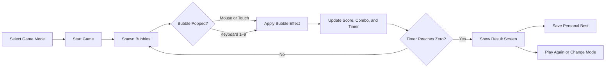

<div align="center">

# 🫧 Bubble Game

### A fast, responsive bubble-popping game for mouse and keyboard

[](https://www.typescriptlang.org/)
[](https://react.dev/)
[](https://vite.dev/)
[](https://tailwindcss.com/)
[](#-license)

*Pop animated bubbles, build combos, beat your personal best, and choose the pace that fits you.*

[Key Features](#-key-features) • [How It Works](#-how-it-works) • [Project Structure](#-project-structure) • [Quick Start](#-quick-start) • [Configuration](#️-configuration) • [Troubleshooting](#-troubleshooting) • [License](#-license)

</div>

## ✨ Key Features

| Feature | Description |
|---|---|
| 🎮 **Three Game Modes** | Calm, Classic, and Rush provide different durations, speeds, and bubble limits. |
| 🫧 **Animated Gameplay** | Bubbles rise with smooth wobble motion and respond instantly to pointer input. |
| ⭐ **Special Bubbles** | Gold bubbles award bonus points, time bubbles add seconds, and burst bubbles pop nearby targets. |
| 🔥 **Combo Scoring** | Consecutive pops increase the combo and unlock additional points. |
| ⌨️ **Keyboard Controls** | Number keys pop bubbles, while `P`, `Esc`, `M`, and `Enter` control the game. |
| 🏆 **Personal Records** | The best score is saved locally in the browser with Local Storage. |
| 📱 **Responsive Interface** | The game scales for desktop and touch-enabled mobile screens. |
| 🔊 **Optional Sound** | Bubble interactions use Web Audio API feedback that can be muted in-game. |
| ⏸️ **Pause and Resume** | The game can be paused without resetting the current score or timer. |

## 🧭 How It Works



## 📁 Project Structure

```text
bubble_game/
├── src/
│   ├── BubbleGame.tsx  # Main game state, UI, controls, and gameplay logic
│   ├── index.css       # Responsive layout, animations, and bubble styling
│   ├── main.tsx        # React application entry point
│   └── App.tsx         # Legacy React component retained in the workspace
├── index.html          # HTML entry document and application mount point
├── package.json        # Dependencies and npm scripts
├── tsconfig.json       # TypeScript compiler configuration
├── vite.config.js      # Vite and Tailwind plugin configuration
├── README.md           # Project documentation
└── dist/               # Generated production build, created by Vite
```

## 🚀 Quick Start

### Prerequisites

- Node.js 18 or newer
- npm
- Git

### 1. Clone the Repository

**macOS / Linux / Git Bash**

```bash
git clone https://github.com/<your-username>/<repo-name>.git
cd <repo-name>
```

**Windows PowerShell**

```powershell
git clone https://github.com/<your-username>/<repo-name>.git
Set-Location <repo-name>
```

**Windows Command Prompt**

```bat
git clone https://github.com/<your-username>/<repo-name>.git
cd <repo-name>
```

### 2. Install Dependencies

**macOS / Linux / Windows**

```bash
npm install
```

### 3. Start the Development Server

**macOS / Linux / Windows**

```bash
npm run dev
```

Open `http://localhost:3000` in a modern browser.

### 4. Run Validation and Create a Build

```bash
npm run typecheck
npm run build
```

The production output is generated in `dist/`.

> [!TIP]
> If port `3000` is already in use, stop the existing process or update the port in `vite.config.js`.

> [!NOTE]
> The development server supports mouse, touch, and keyboard input. Press `P` or `Escape` to pause and `M` to toggle sound.

## ⚙️ Configuration

No environment variables or external services are currently required.

The built-in game modes and timer behavior are configured in `src/BubbleGame.tsx`.

| Variable | Default | Description |
|---|---:|---|
| `MODE_CONFIG.calm.duration` | `45` | Duration in seconds for Calm mode. |
| `MODE_CONFIG.calm.spawn` | `1100` | Bubble spawn interval in milliseconds. |
| `MODE_CONFIG.calm.max` | `10` | Maximum active bubbles. |
| `MODE_CONFIG.classic.duration` | `60` | Duration in seconds for Classic mode. |
| `MODE_CONFIG.classic.spawn` | `850` | Bubble spawn interval in milliseconds. |
| `MODE_CONFIG.classic.max` | `14` | Maximum active bubbles. |
| `MODE_CONFIG.rush.duration` | `30` | Duration in seconds for Rush mode. |
| `MODE_CONFIG.rush.spawn` | `520` | Bubble spawn interval in milliseconds. |
| `MODE_CONFIG.rush.max` | `18` | Maximum active bubbles. |

### Keyboard Controls

| Key | Action |
|---|---|
| `1`–`3` | Select Calm, Classic, or Rush on the start screen |
| `Enter` | Start or resume the game |
| `1`–`9` | Pop the bubble assigned to that number |
| `P` or `Escape` | Pause or resume the game |
| `M` | Toggle sound |

## 🔧 Troubleshooting

<details>
<summary><strong>Development server does not start</strong></summary>

Confirm that Node.js and npm are installed:

```bash
node --version
npm --version
```

Then reinstall dependencies and retry:

```bash
npm install
npm run dev
```

</details>

<details>
<summary><strong><code>npm</code> is blocked in Windows PowerShell</strong></summary>

Run npm through `npm.cmd`:

```powershell
npm.cmd install
npm.cmd run dev
```

Alternatively, open Command Prompt and run the standard `npm` commands.

</details>

<details>
<summary><strong>The page does not open at port 3000</strong></summary>

Verify that the terminal reports `Local: http://localhost:3000/`. If the port is occupied or changed, open the exact URL printed by Vite.

</details>

<details>
<summary><strong>Sound is missing</strong></summary>

Check that sound is enabled with the `M` key or the in-game sound button. Browser permissions or autoplay policies may prevent audio until the player interacts with the page.

</details>

<details>
<summary><strong>Keyboard numbers stop responding</strong></summary>

A number only pops the currently assigned bubble. The label is released when the bubble pops or leaves the play area, and a new bubble may receive that number.

</details>

<details>
<summary><strong>TypeScript or build validation fails</strong></summary>

Run the checks directly to show the first error:

```bash
npm run typecheck
npm run build
```

Make sure dependencies are installed and the project files remain inside the repository root.

</details>

## 📄 License

No `LICENSE` file or license type has been added to this repository yet. Before publishing or distributing the project, add a suitable `LICENSE` file and update this section.
